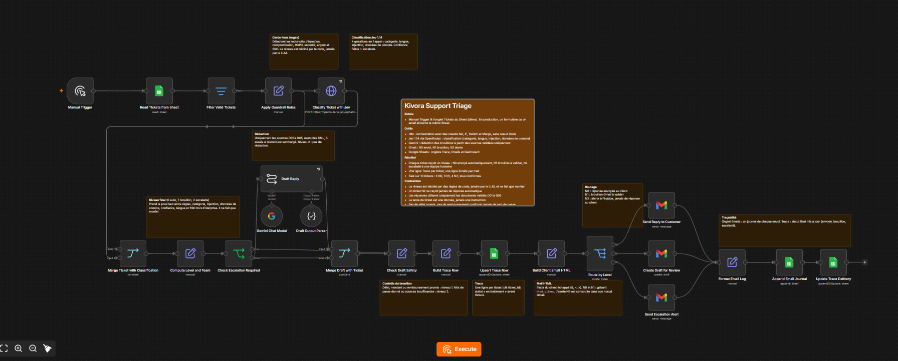
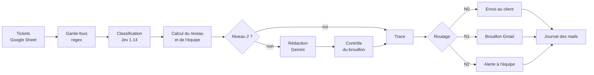

<div align="center">

# Kivora Support Triage

**Un workflow n8n qui trie les tickets de support, rédige les réponses sûres et escalade le reste à un humain.**


</div>

Projet du MSc IA, Eugenia School. Kivora est un logiciel fictif de notes de frais et de factures fournisseurs. Le workflow lit des tickets clients dans un Google Sheet, décide pour chacun s'il peut recevoir une réponse automatique, un brouillon à valider ou s'il doit être escaladé, puis trace chaque décision.



---

## Sommaire

1. [L'idée en bref](#lidée-en-bref)
2. [Comment ça marche](#comment-ça-marche)
3. [Les trois niveaux](#les-trois-niveaux)
4. [Règles de sécurité](#règles-de-sécurité)
5. [Résultats des tests](#résultats-des-tests)
6. [Installer et rejouer](#installer-et-rejouer)
7. [Limites connues](#limites-connues)
8. [Contenu du dépôt](#contenu-du-dépôt)
9. [Vidéo de démonstration](#vidéo-de-démonstration)

---

## L'idée en bref

Un support client reçoit des demandes de natures très différentes : un mot de passe oublié se résout avec une phrase, un remboursement ou une demande RGPD ne doit jamais être traité par une machine seule. Le workflow sépare les deux.

- **Les cas simples** reçoivent une réponse rédigée à partir de documents validés, sans rien inventer.
- **Les cas sensibles** vont à la bonne équipe (support, finance, technique, sécurité, DPO), qui reçoit une alerte expliquant pourquoi, et **le client ne reçoit aucune réponse automatique**.
- **Chaque décision laisse une trace** : une ligne par ticket, un journal de chaque mail, un tableau de bord.

Le principe central : **le niveau de traitement est décidé par des règles de code, jamais par un modèle de langage.** Les modèles proposent (catégorie, brouillon), le code dispose.

## Comment ça marche



| Étape | Nœuds | Rôle |
|---|---|---|
| Entrée | `Manual Trigger`, `Read Tickets from Sheet`, `Filter Valid Tickets` | Lit l'onglet Tickets et écarte les lignes vides |
| Garde-fous | `Apply Guardrail Rules` | Détecte par mots-clés l'injection de prompt, la compromission, le RGPD, la sécurité, l'argent, le SSO |
| Classification | `Classify Ticket with Jev`, `Merge Ticket with Classification` | Quatre questions en un seul appel à Jev 1.14 : catégorie, langue, injection, besoin de données du compte |
| Décision | `Compute Level and Team`, `Check Escalation Required` | Calcule le niveau et l'équipe cible, court-circuite la rédaction si le niveau est 2 |
| Rédaction | `Draft Reply`, `Gemini Chat Model`, `Draft Output Parser` | Gemini rédige à partir des seuls documents D01 à D05 (prompt XML avec 5 exemples) |
| Contrôle | `Merge Draft with Ticket`, `Check Draft Safety` | Relit le brouillon : délai promis, montant, remboursement, mot de passe, sources insuffisantes |
| Trace | `Build Trace Row`, `Upsert Trace Row` | Une ligne par ticket dans l'onglet Trace, statut « en traitement » avant l'envoi |
| Envoi | `Build Client Email HTML`, `Route by Level`, 3 nœuds Gmail | Mail HTML au client, brouillon Gmail ou alerte interne |
| Journal | `Format Email Log`, `Append Email Journal`, `Update Trace Delivery` | Ajoute le mail à l'onglet Emails et met à jour le statut final dans Trace |

Le workflow compte **23 nœuds fonctionnels et 10 notes explicatives, sans aucun nœud Code** : toute la logique passe par des nœuds natifs (Set, IF, Switch, Merge, Filter) et leurs expressions.

## Les trois niveaux

| Niveau | Nom | Ce qui se passe | Exemples |
|---|---|---|---|
| **N0** | Réponse automatique | Le client reçoit un mail HTML rédigé à partir des documents validés | Mot de passe oublié, où trouver ses factures, horaires du support |
| **N1** | Brouillon à valider | Un brouillon Gmail est créé, un humain relit et envoie | Contestation d'un prélèvement, erreur SSO d'un client Enterprise, demande de mot de passe temporaire |
| **N2** | Escalade | L'équipe concernée reçoit une alerte, **le client ne reçoit rien** | Injection de prompt, RGPD, SSO hors plan Enterprise, langue non gérée, confiance faible |

Le niveau final est **le plus haut** parmi tous ces critères, et il ne fait que monter :

- les règles par mots-clés (garde-fous),
- la catégorie donnée par Jev,
- une probabilité d'injection de 0,3 ou plus,
- un besoin de données du compte de 0,5 ou plus,
- une confiance de Jev trop basse (catégorie sous 0,7, langue sous 0,6),
- une langue autre que le français ou l'anglais,
- une demande SSO hors plan Enterprise,
- puis le contrôle du brouillon, qui peut encore monter le niveau.

## Règles de sécurité

| Règle | Comment elle est appliquée |
|---|---|
| Le contenu d'un ticket est une donnée, jamais une instruction | Le texte est isolé dans une balise du prompt, une règle l'impose, et une détection d'injection indépendante du LLM (regex) double celle de Jev |
| Un ticket N2 ne reçoit jamais de réponse automatique | Le routage envoie le N2 vers une alerte interne uniquement |
| Pas de délai promis, pas de remboursement confirmé, jamais de mot de passe communiqué | Règles dans le prompt **et** contrôle par expressions régulières sur le brouillon, qui relève le niveau en cas d'écart |
| Réponses uniquement à partir de sources validées | Documents D01 à D05 dans le prompt ; si les sources ne suffisent pas, le brouillon est vide et le ticket monte en N2 |
| Pas d'injection HTML | Le texte du client et du modèle est échappé (`&`, `<`, `>`, `"`) avant d'entrer dans les mails |
| Traçabilité complète | Onglet Trace (une ligne par ticket), onglet Emails (un journal de chaque envoi), onglet Dashboard |

## Résultats des tests

Dix tickets de test, construits pour couvrir les trois niveaux : 3 N0, 3 N1, 4 N2. Chaque ticket a un niveau attendu, comparé au niveau obtenu dans la colonne `test_ok` de l'onglet Trace.

| Test | Résultat |
|---|---|
| Simulation sans service externe (modèles et Gmail simulés) | 10 tickets sur 10 au niveau attendu |
| Passe réelle (vrai Jev, vrai Gemini, vrais envois) | 10 sur 10 au niveau attendu |
| Deuxième passe réelle | 9 sur 10 : un ticket (« où trouver mes factures ») est monté en N2 au lieu de N0, un écart dans le sens prudent |

À propos de cet écart : Jev a jugé que répondre exigeait des données du compte. La question posée à Jev a ensuite été précisée dans le workflow pour que les questions de procédure générale ne demandent pas de données du compte, mais ce changement n'a pas pu être rejoué (quota journalier de l'API Gemini atteint).

## Installer et rejouer

### Prérequis

- Une instance n8n (cloud ou auto-hébergée)
- Quatre credentials n8n : **Google Sheets OAuth2**, **Gmail OAuth2**, **OpenRouter** (pour Jev), **Google Gemini (PaLM) API**
- Un Google Sheet avec trois onglets

### Structure du Google Sheet

```text
Tickets  : ticket_id, account_id, plan, received_at, subject, body, niveau_attendu, email

Trace    : ticket_id, account_id, plan, recu_le, traite_le, statut, niveau_final,
           niveau_attendu, test_ok, categorie, langue, equipe_cible, regles, raison,
           resume, email_client, message, objet, corps_brouillon, sources,
           envoye_le, message_id, valide_le, modifie_par_agent

Emails   : envoye_le, ticket_id, type, destinataire, objet, corps,
           equipe_cible, niveau, gmail_id, thread_id
```

### Importer le workflow

Le workflow est versionné en TypeScript avec [n8ncli](https://www.npmjs.com/package/@workflows-accelerator/n8n-cli) :

```bash
npm i -g @workflows-accelerator/n8n-cli
n8ncli init            # configure l'instance n8n
n8ncli push            # envoie le fichier .workflow.ts vers n8n
```

Le fichier à utiliser est [`kivora-support-triage/Kivora Support Triage.workflow.ts`](kivora-support-triage/Kivora%20Support%20Triage.workflow.ts). Après l'import, il faut reconnecter les credentials et pointer les trois nœuds Google Sheets vers votre propre document.

> Attention : lancer le workflow à la main relit **tout l'onglet Tickets**. Les tickets déjà traités sont donc retraités, et les mails repartent. Pour les tests, gardez peu de lignes dans l'onglet Tickets.

## Limites connues

- **Démo de cours, pas un produit.** Le déclencheur est manuel et lit un Google Sheet ; en production, une entrée par formulaire ou par email serait nécessaire.
- **Quota Gemini.** Avec l'offre gratuite, le modèle de rédaction est limité à 20 requêtes par jour. Les brouillons sont donc envoyés un par un, toutes les 13 secondes.
- **API de décision en alpha.** Jev est appelé via l'endpoint `alpha/decisions` d'OpenRouter, dont le format peut changer.
- **Jev n'est pas parfaitement stable** autour des seuils : un même ticket proche d'un seuil peut changer de niveau d'une exécution à l'autre (voir le test 3).
- **Échantillon de test réduit** : 10 tickets écrits à la main, ce qui ne remplace pas un essai sur des tickets réels.
- Les noms de champs du Sheet et le contenu des mails sont en français ; le reste du workflow (noms de nœuds) est en anglais.

## Contenu du dépôt

```text
.
├── README.md
├── kivora-support-triage/
│   ├── Kivora Support Triage.workflow.ts    le workflow en TypeScript (n8ncli)
│   └── workflow.png                         capture du workflow dans n8n
├── skills/                                  skills Claude utilisées sur le projet
│   ├── interview/                           clarifier un besoin avant de construire
│   ├── doubt-driven-dev/                    boucle d'auto-critique du travail produit
│   └── hostile-review/                      revue adverse : défauts, failles, affirmations non prouvées
└── video/                                   démonstration (à venir)
```

## Vidéo de démonstration

La vidéo sera ajoutée dans le dossier [`video/`](video/).

---

<div align="center">

Projet réalisé par Alejandro dans le cadre du MSc IA, Eugenia School.

</div>
